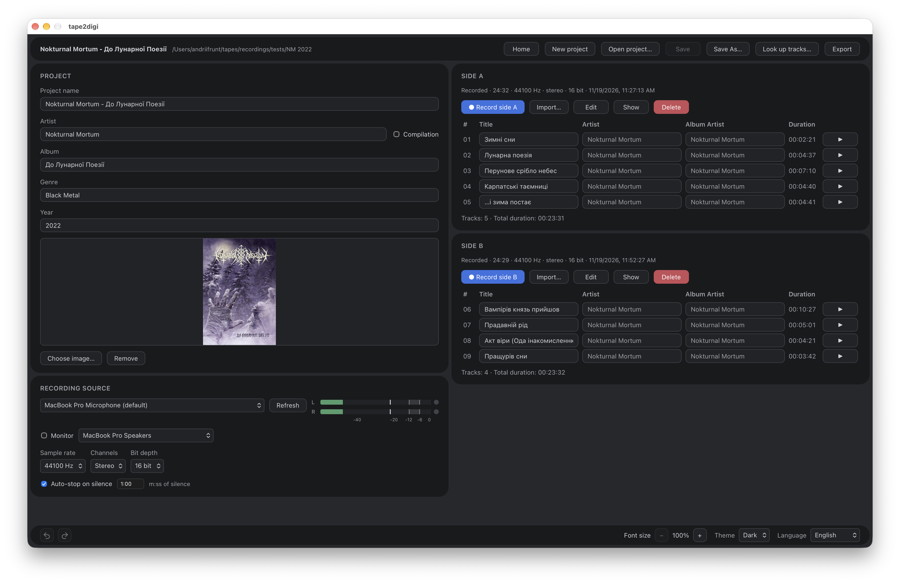

# tape2digi

**Digitise your audio cassettes with a few clicks.**

**[⬇ Download](https://github.com/afrunt/tape2digi/releases)** for macOS, Windows and Linux.

English (US) · [Українська](#tape2digi-українська)



## Bring your tapes back to life

Somewhere in a drawer there is a box of cassettes: albums you loved, mixtapes from friends, songs taped off the radio, voices of your family. Tapes slowly wear out and cassette players are getting rare. tape2digi helps you save that music while it still plays, and turns every tape into a tidy digital album for your phone, your computer or your car.

It is free, needs no account and keeps everything on your computer.

## What you need

* A cassette deck or player that still plays well. A deck with a **line out** (two RCA sockets) gives the best sound; the **headphone** socket of a portable player works too.
* A cable from the player to your computer: into the computer's **line-in**, or into a small **USB audio interface** if your computer has only a headset socket or none at all.
* tape2digi for your computer: macOS, Windows or Linux, from the [Releases page](https://github.com/afrunt/tape2digi/releases).

Tip: play the tape and set the player's volume so the loudest parts reach the marked zone on the level meter but never touch its end. If a **Clipping** badge appears after recording, turn the volume down a little and record again.

## How it works

1. **Start a project** for your tape: give it a name and, if you like, a photo of the cover.
2. **Choose the input** your player is plugged into and check that the meters move.
3. **Record side A**, play the tape, then do the same for side B. tape2digi stops by itself when the side ends.
4. **Find the songs**: **Split** finds the pauses between them; type the titles or let tape2digi look them up online.
5. **Save**, then **Export** the album as music files with titles, artist and cover, ready for your music library.

## What tape2digi does for you

* **Records from any input**: line-in, a microphone or a USB audio interface, with live level meters, and lets you listen along while recording.
* **Knows about side A and side B** and stops recording by itself when the music on a side ends.
* **Finds the songs** on a side for you and lets you fine-tune where each one starts and ends.
* **Fills in the track titles** from an online music database if you want, together with the album cover.
* **Cleans up the sound**: makes quiet tapes louder, reduces tape hiss and hum, and fixes common tape problems such as a weaker channel or a tape head that was slightly out of line.
* **Brings in files you already have**, so a side digitised earlier can join the project.
* **Exports** to the formats every player understands, with titles, artists and cover art.
* **Lets you change your mind**: nearly every step can be undone, and nothing is final until you press **Save**.

## Why tape2digi

* **Made for cassettes**: recording, finding the songs, cleaning up and naming in one place, instead of juggling a recorder and a sound editor.
* **Your recordings are safe**: a new recording replaces nothing until you press **Save**, and a recording interrupted by a crash can be recovered.
* **Private**: no account, everything stays on your computer. The only online feature, the track lookup, is off until you switch it on and sends only the artist and album name you search for.
* **Exporting never changes your project**, so you can export again in another format at any time.
* **Works the same on macOS, Windows and Linux**, in a dark or light look, in English or Ukrainian.

## Using tape2digi

### Projects

* On launch choose **New project** (a folder and a name), **Open project** or a project from the recent list. In a project, **Home** returns to the start screen and **New project** goes straight to the create form. **File → Open project…** (`Cmd/Ctrl+O`) or the **Open project…** button opens another project at any time. A running recording is stopped and unsaved changes are asked about first. Folder pickers open where you last chose a project folder.
* Fill in **Artist**, **Album**, **Year** and **Genre** (with suggestions; any text works). For a tape with various artists tick **Compilation**: the Artist field is disabled, the **Album Artist** column is hidden and the album artist becomes `V/A`; the typed artist is kept and still used for tracks without their own.
* Add a cover image (PNG or JPEG) if you like.
* Changes are kept as you type and **Save** lights up at once. **Save** (`Cmd/Ctrl+S`) writes them; **Save As…** (`Cmd/Ctrl+Shift+S`) copies the whole project, with those changes, to a new folder and opens the copy. Closing the project or the app with unsaved changes asks first.

### Online track lookup

* **Look up tracks…** (the toolbar button right before **Export**, also in the **File** menu) searches [MusicBrainz](https://musicbrainz.org) for your tape by its Artist and Album. It is available once a side has at least one marked track. The lookup is off until you allow it on first use; switch it on or off at any time with **Tools → Online Track Lookup**. Only the artist and album text is sent and the cover comes from the Cover Art Archive; no audio or other data leaves your computer.
* Pick the matching release and check how its tracks fit side A and side B. **Apply** fills in the titles (and the track artists where they differ) as one step per side that you can undo, fills Artist, Album and Year only where they are empty, and can use the release cover.
* The found track list is saved with the side.

### Recording

* Choose the input; the meter next to it shows the left and right levels (one bar for mono). The quality (sample rate, mono or stereo, bit depth) can be changed before recording; the defaults suit cassettes.
* **Monitor** (off by default) lets you listen to the input on the output chosen next to it. **System default** is the computer's current output when the monitor starts; a device you choose is remembered. Changing the output while listening does not touch the recording; if the sound does not follow a later change of the system output, toggle Monitor or pick the output again. Do not use it with a microphone near speakers: it causes feedback.
* Press **Record side A** or **Record side B**; pause, resume and stop as you need, or use the keys: `Cmd/Ctrl+R` records the next empty side, `Space` pauses or resumes, `Esc` stops. If no sound arrives for a while, a **No signal** note appears next to the timer: check the input and the player's volume. You are asked before a recorded side is replaced, and until **Save**, **Undo** brings the old recording back with its track marks and titles (also after importing or recovering a take over it).
* **Auto-stop on silence** (on by default) ends the recording by itself when the side has been silent for the time you set (1 minute by default) and trims the silence at the end. It adapts to the noise of your tape, and a note on the side tells you when a recording was stopped this way.
* After a recording, an import or an edit, tape2digi checks the side for distortion from a too high level (clipping); a **Clipping: N** badge shows how many places it found.
* A new recording or import is kept aside and the project shows unsaved changes until you press **Save**; **Discard** drops it. If the app is closed unexpectedly during a recording, the project offers to **Recover** or delete that take the next time you open it.
* **Import…** on a side turns an existing WAV, MP3, FLAC or Ogg Vorbis file into that side. Import can be cancelled.
* **Delete** on a side removes its recording, with its track marks and titles, after you confirm. The side disappears at once, **Undo** brings it back, **Discard** cancels the deletion, and only **Save** removes the file for good. It is not available while recording or while another task runs.
* On macOS the first start asks for microphone access. If you denied it, allow it in System Settings → Privacy & Security → Microphone.

### Editing a side

**Edit** on a recorded or imported side opens the editor with a waveform for each channel. It is available while nothing is being recorded, imported or copied with Save As.

* **Listen and move around**: click to move the playhead; **Play/Pause** plays the side on the monitor output (Monitor and playback never run together). Zoom with `-`/`+`, **Fit** or `Ctrl/Cmd` + mouse wheel and scroll sideways with the scrollbar or a horizontal wheel; a ruler shows the time and the view follows playback. Tape-deck style level meters show the sound being played.
* **Markers** show where each track starts and ends. Right click the waveform to add a start or end marker (they alternate: start, end, start, end), drag a marker to move it, or right click it and choose **Delete marker** (deleting a start also deletes its end). Markers count as unsaved changes until **Save**.
* **Split** finds the songs for you: it looks for pauses, fades and sudden drops between songs and sets a start and an end for every track, cutting at the quietest point so no music is lost. Songs that run straight into each other need a marker by hand. Split replaces all markers in one step that **Undo** reverts, and is disabled when no clear gaps are found.
* **Amplify** makes the side as loud as it can be without distortion. **Normalize…** brings the side to the loudness you choose, so all your tapes play equally loud. Both can be undone; **Save** keeps the result and **Discard** restores the original.
* **Fix Noise** reduces steady tape hiss and hum, learning the noise from the quiet places between the songs and at the start; some hiss under loud music remains. It is disabled when it finds no steady noise or the noise is already low, so also after it has run.
* **Repair…** checks the side and offers only the fixes it needs: **DC offset** removal, a **Hum** filter for mains hum, **Balance** for a quieter channel, **Azimuth** to line up a channel delayed by a tilted tape head, and **Mono** from left, right or both. Each fix is applied separately and can be undone.
* **Spectrogram**: the **Waveform** / **Spectrogram** switch shows the sound as frequencies over time, so hum (low lines), hiss (haze at the top) and clicks (vertical streaks) are easy to spot; it follows zoom and scroll.
* **Clips**: places with distortion are marked on the ruler, and **Next clip** moves the playhead to the next one.
* **Keys**: `S` / `E` add a start / end marker at the playhead, `[` and `]` jump to the previous / next marker, `Home` / `End` go to the start / end, `Space` plays or pauses.
* **Reset** removes all markers of the side, with their titles and artists, in one step that **Undo** reverts; it is disabled when there are no markers.
* **Undo / Redo** (the buttons at the left of the bottom bar next to the unsaved-changes dot, the **Edit** menu, `Cmd/Ctrl+Z`; redo `Cmd+Shift+Z` on macOS, `Ctrl+Y` elsewhere) work for markers, Split, the sound tools, side deletion and replacing a side with a new recording, import or recovered take, until **Save** or **Discard**. With the editor closed they undo or redo the most recent editor change of either side.

### Track table and player

* Once a side has marked tracks, a **track table** appears under that side: the number (continuing from side A to side B), the **Title**, **Artist** and **Album Artist** you can edit, and the length of each track, with the track count and total time below. An empty artist shows the project's Artist (unless the tape is a compilation); typing replaces it.
* The table follows every marker change in the editor. Titles are stored with the markers, so Split, which replaces all markers, clears them, and **Undo** brings them back.
* The play button at the end of a track row opens a player for that track alone: Play/Pause, Stop, click or drag on the waveform to move the playhead, and the same zoom as the editor.

### Exporting

**Export** (the last toolbar button, the **File** menu item, `Cmd/Ctrl+E`) writes the marked tracks from the current audio and markers, even unsaved ones; your project is not changed. It is available once a side has at least one marked track.

* Choose **WAV** or **MP3** (one file per track), or **FLAC + CUE** (one file for the whole album, side A then B, with a cue sheet listing the tracks; both sides must have the same recording format).
* The files carry the titles, artists, album artist, album, year, genre, track numbers, the compilation flag and, optionally, the cover. WAV and MP3 files are named by the **File names** template (`{n} - {title}` by default); the dialog shows the first file name as you type.
* **Write ReplayGain Tags** (on by default) lets players play every track equally loud without changing the audio.
* **Export Original Recording** (off by default) also copies each side's saved recording unchanged as `side-a-recording.wav` and `side-b-recording.wav`.
* **Presets**: **Save as preset…** keeps your export choices (everything but the folder) under a name; choose a preset to fill the dialog, or **Delete preset** to remove it.
* The cover is also saved as `cover.png`.
* After confirming, pick the target folder (the picker opens in the last one you used); existing files are replaced only after you confirm. Export can be cancelled, and unfinished files are removed.

### Language, theme and font size

* English (default) or Ukrainian (Українська): choose it in the bottom bar on any screen; the change applies at once, the File menu included.
* The bottom bar also switches the look between Islands Dark (default) and Islands Light and makes all text larger or smaller with the font size `-`/`+`.
* The main window and the editor reopen with the size and position you left them in.
* The menu bar and the system's own dialogs follow your operating system's look and language.

## Technical details

Built with Go and [Wails v2](https://wails.io) (Svelte + TypeScript UI). Targets: macOS, Windows, Linux on amd64 and arm64. The pure Go MP3 encoder (`shine-mp3`) is LGPL-2.0 licensed.

### Specifications

* **Recording**: 44.1 (default), 48 or 96 kHz; stereo (default) or mono; 16-bit (default) or 24-bit PCM WAV. The meter shows one bar for mono, a dB scale from -40 to 0 dB and a target zone for peaks from -12 to -6 dB. **No signal** appears after 10 s with every channel below -50 dBFS while recording (not while paused) and disappears when sound returns. Monitor is never remembered and is off at launch; a remembered output device is matched by name and falls back to the system default when missing; whether a running monitor follows a later change of the system default output depends on the OS audio backend.
* **Auto-stop**: **Silence before auto-stop** in m:ss from 0:10 to 10:00 (1:00 by default); the take must be at least 30 s long; the silent tail is trimmed to 2 s; the threshold adapts to the tape's own noise floor; pausing resets the silent stretch.
* **Import**: WAV, MP3, FLAC, Ogg Vorbis (Ogg Opus is not supported). The sample rate is kept; the result is 16-bit, or 24-bit for 24-bit and float sources; sources with more than two channels are mixed down to stereo.
* **Project fields**: Album up to 200 characters (independent of **Compilation**); Year empty or 1900–2100; Genre accepts any text; cover PNG/JPEG up to 20 MB.
* **Track lookup**: the dialog lists title, artist, year, country, formats and track count per release; tracks map to the sides by two media, or one medium split by `A`/`B` numbers or by the recorded side lengths, and for releases with more media you choose which ones; the release cover option is on when the project has no cover.
* **Editor**: available for 16/24-bit WAV sides; zoom down to a 1 s window; level meters with a dB scale (0 to -60 dB), peak hold and a clip lamp. Markers alternate start, end: a start goes only after the last end or into an empty list, an end only after the open start; a dragged marker cannot pass its neighbours; an end can be deleted only when it is the last marker, and its start is left open. Undo keeps up to 100 steps per side, plus project-form edits such as the **Compilation** checkbox.
* **Split**: a gap is silence of at least 2 s much quieter than the music; a fade is at least 6 s well below the music on both sides; a sharp drop into a quieter next song also counts; a fade or drop becomes one cut at its quietest point.
* **Amplify**: the largest gain that does not clip, shown in dB (like Audacity's Amplify); disabled when the side is already at its maximum or silent; the result is a temporary copy until **Save**.
* **Normalize**: measures integrated loudness (EBU R 128 / BS.1770) and applies one gain to a target from -23 to -9 LUFS (default -18), capped so the peak stays at or below -1 dBFS; the panel shows the measured loudness, peak and gain.
* **Fix Noise**: measures the noise spectrum in the quiet stretches (pauses between tracks and the lead-in) and subtracts it from the whole side; disabled when no steady noise pattern is found (for example no quiet stretches) or the noise is already low.
* **Repair**: DC offset removal; a hum notch filter at 50 or 60 Hz and its harmonics; balance of the quieter channel, editable within ±6 dB; azimuth alignment of a delayed channel; mono from left, right or a mix.
* **Clipping**: checked in the background after a take, an import or an edit.
* **Export formats**: WAV in the recorded format or resampled to 44.1, 48, 88.2 or 96 kHz at the same bit depth; MP3 at a constant 128/192/256/320 kbps (320 by default), unavailable for sample rates the encoder cannot handle, such as 96 kHz; FLAC + CUE as one image of the whole album, side A then B, both sides in one format.
* **Tags and cover**: WAV and MP3 carry ID3v2.4 tags (title, artist, album artist, album, year, genre, track number, compilation) and optionally the cover; FLAC carries the same tags as Vorbis comments, plus the cue sheet. For WAV and MP3 the **Maximum cover size (MB)** field (1 MB by default) scales a larger cover down proportionally before embedding, while `cover.png` and FLAC keep the original; `cover.png` is converted when needed.
* **ReplayGain**: measured during export and written as ReplayGain 2.0 track and album gain and peak: ID3 `TXXX` for WAV and MP3, Vorbis comments for FLAC, `REM` lines in the cue sheet. The checkbox is remembered.
* **File names**: tokens `{n}` (two-digit number), `{title}`, `{artist}`, `{album}`, `{year}` and `{side}`; separators next to an empty token are dropped; a track without a title is `Track NN`. An empty template, one over 100 characters, an unknown token or characters not allowed in file names disables Export.
* **Presets**: store the format, bitrate, sample rate, cover options, original recordings, ReplayGain and the file name template, but not the folder; up to 20 presets; an existing name is replaced only after confirmation.
* **Export Original Recording**: remembered and available for every format; it copies the saved files, so unsaved Amplify or Fix Noise results are not included, and a side without a file is skipped.
* **Track table**: the duration is shown as `HH:mm:SS`.
* **Interface**: font size from 100% to 150% in 10% steps; a saved window position that is no longer on a screen is ignored; the native menu bar is not themed; OS-provided texts (system menus, OS dialog buttons, decoder error details) and the window title stay as the OS or library provides them.

### Data

* Settings and local data: `~/.tape2digi/` (`settings.json`, which also holds the export presets, `recent-projects.json`; on Windows also `webview/`).
* A project is a directory with `tape2digi.json` (schema v2), `side-A.wav`, `side-B.wav` and an optional `cover.png`/`cover.jpg`. Renaming a project changes only its name, not its directory. Projects from the earlier schema v1 still open; their old `recordings/` files are kept but not shown, and can be imported into a side. Markers are stored per side (schema stays 2; builds without this feature may drop the field when saving). A looked-up listing is stored per side as `listing`.
* Recorded and imported audio and unsaved edits are kept in temporary files in the project's hidden `.tape2digi-staging` folder; only **Save** moves them into `side-A.wav` / `side-B.wav` (or deletes those files for a deleted side), and discarding drops them.
* Markers are stored per side in `tape2digi.json` as `markers`, with the track titles and artists on them.
* `settings.json` stores `language` (`en`/`uk`), `theme` (`dark`/`light`), `fontScale` (percent), the window sizes and positions, the export choices and presets, and `lastExportDir` / `lastProjectsDir`, the folders the export and project pickers open in (a folder that no longer exists is ignored).
* Limitation: the File menu is native on macOS; on Windows and Linux it appears in the window menu bar, and the same actions are available as buttons in the project header.
* Limitation: on macOS and Linux the system WebView keeps its own cache outside `~/.tape2digi` and this cannot be redirected.

### Build

Run on a Mac; one command builds all six platforms into `dist/`:

```
make doctor   # check prerequisites
make dist     # tape2digi-<version>-<os>-<arch>.{zip,tar.gz} for all targets
make dist-linux-arm64   # a single target (dist-<os>-<arch>)
make clean
```

The same through a script: `./build-dist.sh [--clean] [--skip-doctor] [target ...]` (all targets when none is given; `VERSION=<v>` overrides the version).

Prerequisites: Go 1.26+, Node.js 20+, `zip`, Wails CLI (`go install github.com/wailsapp/wails/v2/cmd/wails@latest`), Xcode command line tools, [llvm-mingw](https://github.com/mstorsjo/llvm-mingw/releases) (ucrt, macOS universal) unpacked in `~/.local/toolchains/` (or `LLVM_MINGW=<dir>`), and a running Docker Desktop for the Linux targets. Version comes from `git describe`.

Development: `wails dev`. Tests: `go test ./...` and `cd frontend && npm run check`.

### Manual verification matrix

Automated tests cover the audio pipeline with a fake device, WAV writing, projects and bindings. These need a human with hardware:

| Check | macOS arm64 | Other platforms |
| --- | --- | --- |
| Real capture from line-in and mic, meters move for L/R and mono | required | smoke test |
| Monitor audible, added latency ≤ ~150 ms, off at launch | required | smoke test |
| Microphone permission prompt appears in the built `.app` | required | n/a |
| 10+ minute recording plays back cleanly, no overruns reported | required | smoke test |
| Unplug device while recording: file kept, error shown | required | smoke test |
| Switching output device while Monitor is on | required | smoke test |
| Choosing a monitor output in the dropdown; remembered after restart; missing device falls back to default | required | smoke test |
| Changing the system default output while Monitor is on (follows or not, per OS) | required | smoke test |
| App launches from the `dist/` artifact | required | smoke test (artifacts are compile-verified only) |
| Start screen: new with name, open, recent, stale recent entry, invalid folder | required | smoke test |
| Rename, cover set/replace/remove, moving the project folder | required | smoke test |
| Hot-plugged USB card appears after «Оновити» | required | smoke test |
| Pause/resume; kill the process mid-recording, WAV and project still open | required | smoke test |
| 90-minute recording: no overruns, valid WAV, plays in a third-party player | required | optional |
| Theme renders as Islands Dark and as Islands Light | required | smoke test |
| Font size `-`/`+`: limits 100% and 150%, kept after restart, no clipped controls at 150% on recorder and editor, both themes and languages | required | smoke test |
| Record side A and B, overwrite warning appears for a recorded side, old audio kept if the new take is empty; after replacing a recorded side, Undo brings back the old take with its marks and titles and Redo the new one (also for import and recover) | required | smoke test |
| Import wav/mp3/flac/ogg from a real file per side, progress and cancel work | required | smoke test |
| Name/cover edits wait for Save; File → Save, Save As copy opens, quit with unsaved edits prompts (including `Cmd+Q`) | required | smoke test |
| Kill the app mid-take, reopen: leftover take is offered for recovery | required | smoke test |
| Side editor: waveform, play/pause/seek by click, marker menu (end disabled before a start), Amplify then Discard/Save, playback on the chosen output | required | smoke test |
| Side editor markers: drag stops at both neighbours, Esc cancels a drag, delete start with and without end, delete last end (a middle end is disabled), persisted after Save and reopen, both languages and themes | required | smoke test |
| Side editor Split: enabled for a recording with clear gaps (tooltip shows the track count), disabled for a continuous one; replaces markers in one undoable step | required | smoke test |
| Side editor Fix Noise: enabled on a noisy recording with quiet pauses, shows progress, lowers the hiss between tracks without dulling the music, then becomes disabled; Undo restores the original | required | smoke test |
| Window geometry: move and resize the main window and the editor, quit and start again: both reopen the same (also maximised main window); disconnect the screen the window was on, the window appears on a visible screen | required | smoke test |
| Track table: place markers, the table lists the tracks with `HH:mm:SS` durations and totals; rename a track and move its marker, the title stays; side B continues the numbering; Undo in the editor changes the table; Genre is saved and restored on reopen | required | smoke test |
| Editor Reset: with markers placed, Reset clears them and the track table; Undo restores markers and titles; disabled with no markers | required | smoke test |
| Undo from the main window: edit side A, then side B, close the editor; Undo (button, Edit menu, shortcut) reverts B and then A, Redo reapplies A and then B; disabled while recording or a job runs | required | smoke test |
| Delete a side: confirm, the side disappears and the project is marked changed; Undo (bottom bar, Edit menu, shortcut) restores it with its marks; Discard restores it; after Save the side file is gone and stays gone on reopen; disabled while recording or a job runs | required | smoke test |
| Compilation: ticking it hides the Album Artist column of the track table and exports every file with album artist `V/A`; the project artist stays the default track artist; ticking and unticking can be undone and redone from the main window (Undo/Redo keep the typed text); unticking brings the column and values back | required | smoke test |
| Export: toolbar order is Home, New, Open, Save, Save As, Look up tracks…, Export (Undo, Redo and the unsaved dot are icons at the left of the bottom bar); File > Export (`Cmd/Ctrl+E`) opens the dialog; WAV at each target rate keeps pitch and length; WAV, MP3 (each bitrate) and FLAC + CUE open in a player/tagger with correct tags, cover and track lengths; `cover.png` is written; Export Original Recording adds `side-a-recording.wav`/`side-b-recording.wav` identical to the stored sides for every format; a cover above the size limit is shrunk only inside the tags (cover.png keeps the original); replacing existing files asks first; Cancel leaves no partial files | required | smoke test |
| Recorder layout: project panel first on the left, source panel under it, side A and B panels (with track tables) on the right; both columns scroll independently at the minimum window size | required | smoke test |
| Track player: the play button on a track row opens a player with only that track's waveform; Play/Pause/Stop work, clicking the waveform moves the playhead, playback stops at the track end and when the player closes, zoom matches the editor | required | smoke test |
| Side editor Undo/Redo: buttons, Edit menu and shortcuts revert and repeat marker insert/delete/move and Amplify; disabled when nothing to do; text fields keep their own undo | required | smoke test |
| Side editor zoom: buttons and `Ctrl/Cmd`+wheel zoom, scrollbar and horizontal wheel scroll, playback follows the playhead, marker insert/drag/seek correct at several zoom levels | required | smoke test |

Record results per OS/arch in the pull request or release notes; none of the hardware checks have been run yet.

---


# tape2digi (Українська)

**Оцифровуйте аудіокасети кількома кліками.**

**[⬇ Завантажити](https://github.com/afrunt/tape2digi/releases)** для macOS, Windows і Linux.

[English (US)](#tape2digi) · Українська


## Поверніть своїм касетам життя

Десь у шухляді лежить коробка з касетами: улюблені альбоми, збірки від друзів, пісні, записані з радіо, голоси рідних. Плівка поступово зношується, а касетних програвачів стає дедалі менше. tape2digi допоможе зберегти цю музику, поки вона ще грає, і перетворить кожну касету на охайний цифровий альбом для телефона, комп'ютера чи автомобіля.

Застосунок безкоштовний, не потребує облікового запису й зберігає все на вашому комп'ютері.

## Що потрібно

* Касетна дека або плеєр, що ще добре грає. Найкращий звук дає дека з виходом **line out** (два гнізда RCA); підійде й гніздо **навушників** портативного плеєра.
* Кабель від плеєра до комп'ютера: у вхід **line-in** комп'ютера або в невеликий **USB-аудіоінтерфейс**, якщо на комп'ютері є лише гніздо гарнітури чи немає жодного.
* tape2digi для вашого комп'ютера: macOS, Windows або Linux, зі [сторінки релізів](https://github.com/afrunt/tape2digi/releases).

Порада: увімкніть касету й налаштуйте гучність плеєра так, щоб найгучніші місця доходили до позначеної зони на індикаторі рівня, але ніколи не торкалися його кінця. Якщо після запису з'явилася позначка **Clipping**, трохи зменште гучність і запишіть ще раз.

## Як це працює

1. **Створіть проєкт** для касети: дайте йому назву й, за бажанням, додайте фото обкладинки.
2. **Оберіть вхід**, до якого підключено плеєр, і перевірте, що індикатори рухаються.
3. **Запишіть сторону A**, відтворюючи касету, а потім так само сторону B. tape2digi сам зупиниться, коли сторона закінчиться.
4. **Знайдіть пісні**: **Split** знаходить паузи між ними; введіть назви або дайте tape2digi знайти їх онлайн.
5. Натисніть **Save**, а потім **Export**, щоб отримати альбом у музичних файлах із назвами, виконавцем і обкладинкою, готовий для вашої фонотеки.

## Що tape2digi робить для вас

* **Записує з будь-якого входу**: line-in, мікрофона чи USB-аудіоінтерфейсу, з індикаторами рівня в реальному часі, і дає слухати звук під час запису.
* **Знає про сторони A і B** і сам зупиняє запис, коли музика на стороні закінчується.
* **Знаходить пісні** на стороні й дає точно підправити, де кожна починається й закінчується.
* **Заповнює назви треків** з онлайн-бази музики, якщо ви цього хочете, разом з обкладинкою альбому.
* **Покращує звук**: робить тихі касети гучнішими, зменшує шипіння й гул плівки та виправляє типові вади касет, як-от тихіший канал чи трохи перекошену магнітну головку.
* **Додає файли, що вже є**, тож сторона, оцифрована раніше, може стати частиною проєкту.
* **Експортує** у формати, які розуміє будь-який програвач, з назвами, виконавцями й обкладинкою.
* **Дозволяє передумати**: майже кожен крок можна скасувати, і нічого не остаточне, доки ви не натиснете **Save**.

## Чому tape2digi

* **Створено для касет**: запис, пошук пісень, очищення звуку й назви в одному місці, без жонглювання записувачем і звуковим редактором.
* **Ваші записи в безпеці**: новий запис нічого не замінює, доки ви не натиснете **Save**, а запис, перерваний збоєм, можна відновити.
* **Приватно**: без облікового запису, усе лишається на вашому комп'ютері. Єдина онлайн-функція, пошук треків, вимкнена, доки ви її не ввімкнете, і надсилає лише назву виконавця й альбому, які ви шукаєте.
* **Експорт ніколи не змінює проєкт**, тож будь-коли можна експортувати ще раз в іншому форматі.
* **Однаково працює на macOS, Windows і Linux**, у темному чи світлому вигляді, англійською чи українською.

## Використання

### Проєкти

* Після запуску оберіть **New project** (тека й назва), **Open project** або проєкт зі списку недавніх. У проєкті **Home** повертає на стартовий екран, а **New project** одразу відкриває форму створення. **File → Open project…** (`Cmd/Ctrl+O`) або кнопка **Open project…** будь-коли відкриває інший проєкт. Запущений запис зупиняється, а про незбережені зміни спершу запитують. Вибір теки відкривається там, де ви востаннє обирали теку проєкту.
* Заповніть **Artist**, **Album**, **Year** і **Genre** (з підказками; підійде будь-який текст). Для касети з різними виконавцями позначте **Compilation**: поле Artist вимикається, стовпець **Album Artist** ховається, а виконавцем альбому стає `V/A`; введений виконавець зберігається й далі використовується для треків без власного.
* За бажанням додайте обкладинку (PNG або JPEG).
* Зміни запам'ятовуються під час введення, і **Save** одразу стає активною. **Save** (`Cmd/Ctrl+S`) записує їх; **Save As…** (`Cmd/Ctrl+Shift+S`) копіює весь проєкт разом із цими змінами в нову теку й відкриває копію. Закриття проєкту чи застосунку з незбереженими змінами спершу запитує.

### Пошук треків онлайн

* **Look up tracks…** (кнопка панелі інструментів одразу перед **Export**, а також у меню **File**) шукає касету в [MusicBrainz](https://musicbrainz.org) за її Artist і Album. Пошук доступний, коли на стороні є хоча б один позначений трек. Він вимкнений, доки ви не дозволите його під час першого використання; вмикайте й вимикайте його будь-коли через **Tools → Online Track Lookup**. Надсилається лише текст виконавця й альбому, а обкладинка завантажується з Cover Art Archive; жоден звук чи інші дані не залишають комп'ютер.
* Оберіть відповідний реліз і перевірте, як його треки лягають на сторони A і B. **Apply** заповнює назви (і виконавців треків, де вони відрізняються) одним кроком на сторону, який можна скасувати, заповнює Artist, Album і Year лише там, де вони порожні, і може взяти обкладинку релізу.
* Знайдений список треків зберігається разом зі стороною.

### Запис

* Оберіть вхід; індикатор поруч показує рівні лівого й правого каналів (одна смуга для моно). Якість (частоту дискретизації, моно чи стерео, розрядність) можна змінити до запису; значення за замовчуванням підходять для касет.
* **Monitor** (вимкнений за замовчуванням) дає слухати вхід на виході, обраному поруч. **System default** — це поточний вихід комп'ютера на момент запуску монітора; обраний вами пристрій запам'ятовується. Зміна виходу під час прослуховування не впливає на запис; якщо звук не переходить за пізнішою зміною системного виходу, вимкніть і ввімкніть Monitor або оберіть вихід знову. Не вмикайте його з мікрофоном біля динаміків: виникне зворотний зв'язок.
* Натисніть **Record side A** або **Record side B**; ставте на паузу, продовжуйте й зупиняйте, коли потрібно, або клавішами: `Cmd/Ctrl+R` записує наступну порожню сторону, `Space` ставить на паузу чи продовжує, `Esc` зупиняє. Якщо звук довго не надходить, біля таймера з'являється позначка **No signal**: перевірте вхід і гучність плеєра. Перед заміною записаної сторони вас запитають, а до **Save** **Undo** повертає старий запис разом із розмітками й назвами треків (так само після імпорту чи відновлення поверх неї).
* **Auto-stop on silence** (увімкнено за замовчуванням) сам завершує запис, коли сторона мовчить заданий час (за замовчуванням 1 хвилину), і обрізає тишу в кінці. Він підлаштовується під шум вашої касети, а примітка на стороні повідомляє, що запис зупинено саме так.
* Після запису, імпорту чи редагування tape2digi перевіряє сторону на спотворення через надто високий рівень (перевантаження); позначка **Clipping: N** показує, скільки таких місць знайдено.
* Новий запис чи імпорт зберігається окремо, і проєкт показує незбережені зміни, доки ви не натиснете **Save**; **Discard** відкидає їх. Якщо застосунок несподівано закрився під час запису, наступного відкриття проєкт запропонує **Recover** або видалити цей запис.
* **Import…** на стороні перетворює наявний файл WAV, MP3, FLAC або Ogg Vorbis на цю сторону. Імпорт можна скасувати.
* **Delete** на стороні після підтвердження прибирає її запис разом із розмітками й назвами треків. Сторона зникає одразу, **Undo** повертає її, **Discard** скасовує видалення, і лише **Save** остаточно видаляє файл. Кнопка недоступна під час запису або іншої операції.
* У macOS перший запуск запитує доступ до мікрофона. Якщо ви відмовили, дозвольте його в System Settings → Privacy & Security → Microphone.

### Редагування сторони

**Edit** на записаній чи імпортованій стороні відкриває редактор із хвилею для кожного каналу. Він доступний, коли нічого не записується, не імпортується й не копіюється через Save As.

* **Слухайте й переміщайтеся**: клік переміщує позицію відтворення; **Play/Pause** відтворює сторону на виході монітора (Monitor і відтворення ніколи не працюють разом). Масштабуйте `-`/`+`, **Fit** або `Ctrl/Cmd` + коліщатко миші й прокручуйте вбік смугою прокрутки чи горизонтальним коліщатком; лінійка показує час, а вигляд стежить за відтворенням. Індикатори рівня, як на касетній деці, показують звук, що відтворюється.
* **Маркери** показують, де кожен трек починається й закінчується. Правий клік на хвилі додає маркер початку чи кінця (вони чергуються: початок, кінець, початок, кінець), маркер можна перетягнути або клацнути правою кнопкою й обрати **Delete marker** (видалення початку видаляє й його кінець). Маркери вважаються незбереженими змінами до **Save**.
* **Split** знаходить пісні за вас: шукає паузи, затухання й різкі спади між піснями та ставить початок і кінець кожного треку, розрізаючи в найтихішому місці, тож музика не губиться. Для пісень, що переходять одна в одну без спаду, маркер ставиться вручну. Split замінює всі маркери одним кроком, який скасовує **Undo**, і вимкнений, якщо чітких пауз не знайдено.
* **Amplify** робить сторону настільки гучною, наскільки можна без спотворень. **Normalize…** доводить сторону до обраної гучності, тож усі касети звучать однаково гучно. Обидві дії можна скасувати; **Save** зберігає результат, а **Discard** повертає оригінал.
* **Fix Noise** зменшує рівномірне шипіння й гул плівки, вивчаючи шум у тихих місцях між піснями й на початку; трохи шипіння під гучною музикою лишається. Кнопка вимкнена, якщо рівномірного шуму не знайдено або він уже низький, тож і після успішного застосування.
* **Repair…** перевіряє сторону й пропонує лише потрібні виправлення: прибрати **DC offset**, фільтр **Hum** від гулу мережі, **Balance** для тихішого каналу, **Azimuth**, щоб вирівняти канал, затриманий перекошеною головкою, і **Mono** з лівого, правого або обох каналів. Кожне виправлення застосовується окремо й скасовується.
* **Спектрограма**: перемикач **Waveform** / **Spectrogram** показує звук як частоти в часі, тож гул (низькі лінії), шипіння (серпанок угорі) й клацання (вертикальні смуги) легко помітити; вона стежить за масштабом і прокруткою.
* **Перевантаження**: місця зі спотворенням позначено на лінійці, а **Next clip** переводить позицію до наступного.
* **Клавіші**: `S` / `E` додають маркер початку / кінця в позиції відтворення, `[` і `]` переходять до попереднього / наступного маркера, `Home` / `End` — на початок / кінець, `Space` запускає або зупиняє відтворення.
* **Reset** прибирає всі маркери сторони разом із назвами й виконавцями одним кроком, який скасовує **Undo**; кнопка вимкнена, якщо маркерів немає.
* **Undo / Redo** (кнопки ліворуч у нижній панелі поруч із крапкою незбережених змін, меню **Edit**, `Cmd/Ctrl+Z`; повтор `Cmd+Shift+Z` у macOS, `Ctrl+Y` деінде) працюють для маркерів, Split, інструментів звуку, видалення сторони та заміни сторони новим записом, імпортом чи відновленим записом, до **Save** або **Discard**. Коли редактор закритий, вони скасовують або повторюють останню зміну редактора на будь-якій стороні.

### Таблиця треків і програвач

* Коли на стороні є позначені треки, під нею з'являється **таблиця треків**: номер (наскрізний зі сторони A на сторону B), редаговані **Title**, **Artist** і **Album Artist** та тривалість кожного треку, а під таблицею кількість треків і загальний час. Порожній виконавець показує Artist проєкту (якщо касета не збірка); введення замінює його.
* Таблиця стежить за кожною зміною маркерів у редакторі. Назви зберігаються разом із маркерами, тож Split, що замінює всі маркери, очищає їх, а **Undo** повертає.
* Кнопка відтворення в кінці рядка відкриває програвач лише цього треку: Play/Pause, Stop, клік чи перетягування по хвилі для переміщення позиції й такий самий масштаб, як у редакторі.

### Експорт

**Export** (остання кнопка панелі інструментів, пункт меню **File**, `Cmd/Ctrl+E`) записує позначені треки з поточного звуку й маркерів, навіть незбережених; проєкт не змінюється. Експорт доступний, коли на стороні є хоча б один позначений трек.

* Оберіть **WAV** або **MP3** (файл на кожен трек) чи **FLAC + CUE** (один файл на весь альбом, сторона A, потім B, з cue-файлом, що перелічує треки; обидві сторони мають бути в одному форматі запису).
* Файли містять назви, виконавців, виконавця альбому, альбом, рік, жанр, номери треків, ознаку збірки та, за бажанням, обкладинку. Файли WAV і MP3 називаються за шаблоном **File names** (за замовчуванням `{n} - {title}`); діалог показує ім'я першого файлу під час введення.
* **Write ReplayGain Tags** (увімкнено за замовчуванням) дає програвачам відтворювати всі треки однаково гучно без зміни звуку.
* **Export Original Recording** (вимкнено за замовчуванням) також копіює збережений запис кожної сторони без змін як `side-a-recording.wav` і `side-b-recording.wav`.
* **Пресети**: **Save as preset…** зберігає ваш вибір експорту (усе, крім теки) під назвою; оберіть пресет, щоб заповнити діалог, або **Delete preset**, щоб його прибрати.
* Обкладинка також зберігається як `cover.png`.
* Після підтвердження оберіть теку (вибір відкривається в останній використаній); наявні файли замінюються лише після підтвердження. Експорт можна скасувати, а незавершені файли видаляються.

### Мова, тема та розмір шрифту

* Англійська (за замовчуванням) або українська (Українська): оберіть у нижній панелі на будь-якому екрані; зміна діє одразу, разом із меню File.
* Нижня панель також перемикає вигляд між Islands Dark (за замовчуванням) та Islands Light і збільшує чи зменшує весь текст кнопками розміру шрифту `-`/`+`.
* Головне вікно й редактор відкриваються з тим розміром і в тому місці, де ви їх закрили.
* Смуга меню та системні діалоги відповідають вигляду й мові вашої операційної системи.

## Технічні подробиці

Створено на Go та [Wails v2](https://wails.io) (інтерфейс Svelte + TypeScript). Цілі: macOS, Windows, Linux на amd64 та arm64. Чисто Go MP3-кодер (`shine-mp3`) має ліцензію LGPL-2.0.

### Специфікації

* **Запис**: 44,1 (за замовчуванням), 48 або 96 кГц; стерео (за замовчуванням) або моно; 16-бітний (за замовчуванням) або 24-бітний PCM WAV. Для моно індикатор показує одну смугу; шкала в дБ від -40 до 0 дБ і цільова зона для піків від -12 до -6 дБ. **No signal** з'являється, коли під час запису (не на паузі) всі канали 10 с тихіші за -50 dBFS, і зникає, щойно звук повертається. Monitor ніколи не запам'ятовується й вимкнений під час запуску; запам'ятований пристрій виходу шукається за назвою, а якщо його немає, використовується системний вихід за замовчуванням; чи перейде запущений монітор на пізніше змінений системний вихід, залежить від аудіопідсистеми ОС.
* **Автозупинка**: **Silence before auto-stop** у форматі хв:сс від 0:10 до 10:00 (1:00 за замовчуванням); запис має тривати щонайменше 30 с; тиша в кінці обрізається до 2 с; поріг підлаштовується під власний рівень шуму касети; пауза скидає відлік тиші.
* **Імпорт**: WAV, MP3, FLAC, Ogg Vorbis (Ogg Opus не підтримується). Частота дискретизації зберігається; результат 16-бітний або 24-бітний для 24-бітних і float-джерел; джерела з понад двома каналами зводяться до стерео.
* **Поля проєкту**: Album до 200 символів (незалежно від **Compilation**); Year порожній або 1900–2100; Genre приймає будь-який текст; обкладинка PNG/JPEG до 20 МБ.
* **Пошук треків**: діалог показує назву, виконавця, рік, країну, формати й кількість треків для кожного релізу; треки розкладаються на сторони за двома носіями або одним носієм, розділеним за номерами `A`/`B` чи за тривалістю записаних сторін, а для релізів із більшою кількістю носіїв ви обираєте потрібні; опцію обкладинки релізу ввімкнено, коли в проєкті немає обкладинки.
* **Редактор**: доступний для 16/24-бітних сторін WAV; масштаб до вікна в 1 с; індикатори рівня зі шкалою дБ (від 0 до -60 дБ), утриманням піку та лампою перевантаження. Маркери чергуються (початок, кінець): початок ставиться лише після останнього кінця або в порожній список, кінець лише після відкритого початку; перетягнутий маркер не може перейти через сусідні; кінець можна видалити лише тоді, коли він останній маркер, і його початок лишається відкритим. Undo зберігає до 100 кроків на сторону, а також зміни форми проєкту, як-от прапорець **Compilation**.
* **Split**: пауза — це тиша щонайменше 2 с, значно тихіша за музику; затухання — щонайменше 6 с помітно нижче рівня музики з обох боків; різкий спад до тихішої наступної пісні теж враховується; затухання чи спад стає одним розрізом у найтихішій точці.
* **Amplify**: найбільше підсилення без перевантаження, показане в дБ (як Amplify в Audacity); вимкнено, якщо сторона вже на максимумі або тиха; результат лишається тимчасовою копією до **Save**.
* **Normalize**: вимірює інтегровану гучність (EBU R 128 / BS.1770) і застосовує одне підсилення до цілі від -23 до -9 LUFS (за замовчуванням -18), обмежене так, щоб пік лишався не вище -1 dBFS; панель показує виміряну гучність, пік і підсилення.
* **Fix Noise**: вимірює спектр шуму в тихих місцях (паузи між треками й початок) і віднімає його з усієї сторони; вимкнено, якщо рівномірного шуму не знайдено (наприклад, немає тихих місць) або шум уже низький.
* **Repair**: прибирання DC offset; режекторний фільтр гулу на 50 або 60 Гц і гармоніках; баланс тихішого каналу, редагований у межах ±6 дБ; вирівнювання азимуту затриманого каналу; моно з лівого, правого каналу або їх суміші.
* **Перевантаження**: перевіряється у фоні після запису, імпорту чи редагування.
* **Формати експорту**: WAV у форматі запису або з перетворенням до 44,1, 48, 88,2 чи 96 кГц з тією самою розрядністю; MP3 зі сталим бітрейтом 128/192/256/320 кбіт/с (320 за замовчуванням), недоступний для частот, які кодувальник не підтримує, як-от 96 кГц; FLAC + CUE як один образ усього альбому, сторона A, потім B, обидві сторони в одному форматі.
* **Теги й обкладинка**: WAV і MP3 містять теги ID3v2.4 (назва, виконавець, виконавець альбому, альбом, рік, жанр, номер треку, збірка) і, за бажанням, обкладинку; FLAC містить ті самі теги як Vorbis comments разом із cue sheet. Для WAV і MP3 поле **Maximum cover size (MB)** (1 МБ за замовчуванням) пропорційно зменшує більшу обкладинку перед вбудовуванням, а `cover.png` і FLAC зберігають оригінал; `cover.png` за потреби конвертується.
* **ReplayGain**: вимірюється під час експорту й записується як ReplayGain 2.0 (підсилення й пік треку та альбому): ID3 `TXXX` для WAV і MP3, Vorbis comments для FLAC, рядки `REM` у cue sheet. Стан прапорця запам'ятовується.
* **Імена файлів**: токени `{n}` (двоцифровий номер), `{title}`, `{artist}`, `{album}`, `{year}` і `{side}`; роздільники поруч із порожнім токеном відкидаються; трек без назви — `Track NN`. Порожній шаблон, шаблон понад 100 символів, невідомий токен або символи, недопустимі в іменах файлів, вимикають Export.
* **Пресети**: зберігають формат, бітрейт, частоту дискретизації, параметри обкладинки, оригінальні записи, ReplayGain і шаблон імен файлів, але не теку; до 20 пресетів; наявна назва замінюється лише після підтвердження.
* **Export Original Recording**: запам'ятовується й доступний для всіх форматів; копіює збережені файли, тож незбережені результати Amplify чи Fix Noise не потрапляють, а сторона без файлу пропускається.
* **Таблиця треків**: тривалість показується як `HH:mm:SS`.
* **Інтерфейс**: розмір шрифту від 100% до 150% із кроком 10%; збережене положення вікна, яке вже не на жодному екрані, ігнорується; нативна смуга меню не підлаштовується під тему; тексти ОС (системні меню, кнопки системних діалогів, подробиці помилок декодера) і заголовок вікна лишаються такими, як їх надає ОС або бібліотека.

### Дані

* Налаштування та локальні дані: `~/.tape2digi/` (`settings.json`, де також зберігаються пресети експорту, `recent-projects.json`; у Windows також `webview/`).
* Проєкт — це тека з `tape2digi.json` (схема v2), `side-A.wav`, `side-B.wav` та необов'язковою `cover.png`/`cover.jpg`. Перейменування проєкту змінює лише його назву, а не теку. Проєкти зі старої схеми v1 усе ще відкриваються; їхні старі файли `recordings/` зберігаються, але не показуються, і їх можна імпортувати у сторону. Маркери зберігаються по сторонах (схема лишається 2; збірки без цієї можливості можуть втратити поле під час збереження). Знайдений онлайн список сторони зберігається як `listing`.
* Записаний та імпортований звук і незбережені зміни зберігаються в тимчасових файлах у прихованій теці проєкту `.tape2digi-staging`; лише **Save** переносить їх у `side-A.wav` / `side-B.wav` (або видаляє ці файли для видаленої сторони), а відкидання змін їх прибирає.
* Маркери зберігаються по сторонах у `tape2digi.json` як `markers` разом із назвами й виконавцями треків.
* `settings.json` зберігає `language` (`en`/`uk`), `theme` (`dark`/`light`), `fontScale` (відсотки), розміри й положення вікон, вибір експорту та пресети, а також `lastExportDir` / `lastProjectsDir` — теки, у яких відкривається вибір для експорту й проєктів (теку, якої вже немає, ігнорує).
* Обмеження: меню File нативне в macOS; у Windows і Linux воно з'являється в смузі меню вікна, а ті самі дії доступні кнопками в заголовку проєкту.
* Обмеження: у macOS і Linux системний WebView тримає власний кеш поза `~/.tape2digi`, і перенаправити його неможливо.

### Збірка

Запускайте на Mac; одна команда збирає всі шість платформ у `dist/`:

```
make doctor   # check prerequisites
make dist     # tape2digi-<version>-<os>-<arch>.{zip,tar.gz} for all targets
make dist-linux-arm64   # a single target (dist-<os>-<arch>)
make clean
```

Те саме через скрипт: `./build-dist.sh [--clean] [--skip-doctor] [ціль ...]` (усі цілі, якщо жодної не вказано; `VERSION=<v>` перевизначає версію).

Вимоги: Go 1.26+, Node.js 20+, `zip`, Wails CLI (`go install github.com/wailsapp/wails/v2/cmd/wails@latest`), інструменти командного рядка Xcode, [llvm-mingw](https://github.com/mstorsjo/llvm-mingw/releases) (ucrt, macOS universal), розпакований у `~/.local/toolchains/` (або `LLVM_MINGW=<dir>`), і запущений Docker Desktop для Linux-цілей. Версія береться з `git describe`.

Розробка: `wails dev`. Тести: `go test ./...` та `cd frontend && npm run check`.

### Матриця ручної перевірки

Матриця ручних перевірок наведена англійською в розділі «Manual verification matrix» англійської версії вище.
