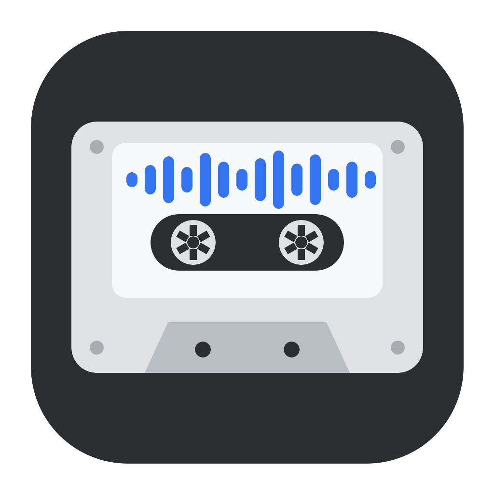

# tape2digi

**Digitise your audio cassettes with a few clicks.**

**[⬇ Download](https://github.com/afrunt/tape2digi/releases)** for macOS, Windows and Linux.

English (US) · [Українська](#tape2digi-українська)


## Introduction

tape2digi is a free desktop app that turns audio cassettes into tidy digital albums. Pick an input (line-in, a microphone, or any capture device on your computer), watch the live left/right levels, record each side of the tape, mark where the tracks start and end, and export ready-to-play WAV, MP3 or FLAC files with titles, artists and cover art.

It runs on macOS, Windows and Linux (amd64 and arm64), has an Islands Dark and Islands Light look, and speaks English and Ukrainian.

## Features

* **Any input**: line-in, microphone or any capture device, with live left/right level meters (one bar for mono).
* **Monitor**: optionally listen to the input on the output you choose, with no effect on the recording.
* **Recording per side**: side A and side B, with pause, resume and stop; 44.1/48/96 kHz, mono or stereo, 16 or 24 bit. Recordings are saved as WAV. **Auto-stop** ends a take after the silence at the end of the tape side (1 minute by default).
* **Import**: convert an existing WAV, MP3, FLAC or Ogg Vorbis file into a side.
* **Projects**: one folder per tape, with name, artist, album, year, genre, cover image and a "Compilation" mode for tapes with various artists.
* **Online track lookup** (optional, off until you enable it): find the release on MusicBrainz, and fill the track titles and cover.
* **Side editor**: waveform with zoom, track start/end markers, **Amplify**, **Split** (finds the gaps between songs), **Fix Noise** (removes steady hiss and hum), **Normalize** (loudness target in LUFS), **Repair** (DC offset, hum, channel balance, azimuth, mono) and **Reset**; a spectrogram view, clip markers and keyboard shortcuts.
* **Track table**: editable title, artist and album artist per track, with durations and totals; paste a whole track list at once or number the untitled tracks.
* **Track player**: preview a single track.
* **Undo / Redo**: up to 100 steps per side, plus project-form edits such as the Compilation checkbox.
* **Export**: WAV (original or resampled), MP3 (128–320 kbps) or FLAC with a CUE sheet; ID3v2.4 tags, embedded and `cover.png` cover, and an optional copy of the original recordings; ReplayGain tags, a file name template and export presets.

## Why tape2digi

* Built for tapes: side A/B, track marking and noise reduction in one place instead of juggling a recorder and an audio editor.
* Safe by design: recordings go to a temporary file and replace the project's audio only when you press **Save**; a take left by a crash can be recovered.
* Nothing is changed by exporting: the project stays as it is.
* Small, native-feeling and self-contained: no account, all data stays on your machine. The only network access is the optional track lookup, which is off until you enable it and sends just the artist and album text you search for.
* Works the same on macOS, Windows and Linux.

## Quick start

Download the app for your platform from the [Releases page](https://github.com/afrunt/tape2digi/releases).

1. Launch tape2digi and choose **New project** (a folder and a name), or **Open project** / a recent project.
2. Select the input device and check that the meters move.
3. Press **Record side A**, play the tape, then stop. Repeat for side B.
4. Open **Edit** on a side, place the track markers (or press **Split**), and name the tracks in the track table.
5. Press **Save**, then **Export**, choose a format and a target folder.

## Using tape2digi

### Projects

* On launch choose **New project** (project folder and name), **Open project** (a folder containing `tape2digi.json`) or a project from the recent list. In a project, **Home** returns to this start screen and **New project** goes straight to the create form (unsaved changes are asked about first). Another project can be opened at any time with **File → Open project…** (`Cmd/Ctrl+O`) or the **Open project…** header button; a running recording is stopped and unsaved changes are asked about first.
* Besides the name there are **Artist** with a **Compilation** checkbox, **Album** (up to 200 characters, independent of **Compilation**), **Year** (empty or 1900–2100) and a general **Genre** field with suggestions (any text is accepted). **Compilation** disables the Artist field for cassettes with various artists, hides the **Album Artist** column of the track table and exports the album artist `V/A`; the typed text is kept, stays the default artist of tracks without their own and is not used as the album artist.
* Set an optional cover image (PNG/JPEG, up to 20 MB).
* Name, cover and these fields are staged as you type and the header **Save** button enables at once. **Save** (`Cmd/Ctrl+S`) writes them; **Save As…** (`Cmd/Ctrl+Shift+S`) copies the whole project, with those edits, to a new folder and opens the copy. Closing the project or the app with unsaved edits asks first.

### Online track lookup

* **Look up tracks…** (project toolbar button right before Export, and the **File** menu item before Export; enabled once a side has at least one complete track) searches [MusicBrainz](https://musicbrainz.org) for the release by the project's Artist and Album. Online lookup is off by default: the first use asks for consent, and it can be switched on or off at any time with **Tools → Online Track Lookup**. Only the search text (artist and album) is sent, and the cover is downloaded from the Cover Art Archive; no audio or other data leaves the computer.
* The dialog lists the matching releases (title, artist, year, country, formats, track count). Choosing one shows how its tracks map to side A and side B (two media, or one medium split by `A`/`B` numbers or by the recorded side lengths; for releases with more media you choose which ones). **Apply** fills the titles (and differing track artists) of the marked tracks in order as one undoable step per side, fills only empty Artist, Album and Year, and optionally uses the release cover (on when the project has no cover).
* The listing is saved with the side.

### Recording

* Select the input device; the meter beside it shows left/right levels (one bar for mono). Defaults are 44.1 kHz, stereo, 16-bit; sample rate (44.1/48/96 kHz), channels and bit depth (16/24) can be changed before recording.
* **Monitor** (off by default, never remembered) plays the input on the output chosen in the dropdown next to it. **System default** is preselected and means the system's current default output at the moment the monitor starts; a specific device is remembered by name and falls back to the default if missing. Changing it while the monitor is on moves the sound without touching the recording. Whether a running monitor follows a later change of the system default output depends on the OS audio backend; toggle Monitor or reselect the output if it does not. Avoid it with a microphone near speakers: it can cause feedback.
* Press **Record side A** or **Record side B**; pause, resume and stop as needed. If a side is already recorded you are asked before it is replaced; until **Save**, **Undo** brings back the old recording with its track marks and titles (the same goes for importing or recovering a take over a recorded side).
* **Auto-stop on silence** (on by default) stops the take by itself after the set **Silence before auto-stop** (m:ss, 0:10 to 10:00, 1:00 by default) once the take is at least 30 s long, and trims the silent tail to 2 s. The threshold adapts to the tape's own noise floor; pausing resets the silent stretch. A notice on the side tells you when a take was stopped this way.
* After a take, import or edit the side is checked for clipping in the background; a **Clipping: N** badge on the side shows how many clipped places were found.
* Recorded and imported audio is kept in temporary files in the hidden `.tape2digi-staging` folder and marks the project as changed; only **Save** moves it into `side-A.wav` / `side-B.wav`, and discarding drops it. If the app is killed during a take, the next time the project is opened it offers to recover (**Recover**) or delete the unsaved take.
* **Import…** on a side converts an existing file (WAV, MP3, FLAC, Ogg Vorbis; Ogg Opus is not supported) into that side's WAV. The sample rate is kept; output is 16-bit, or 24-bit for 24-bit/float sources; sources with more than two channels are mixed down to stereo. Import can be cancelled.
* **Delete** on a side removes its recording (with its track marks and titles) after a confirmation. Like other changes it is staged: the side disappears at once, **Undo** brings it back, **Discard** cancels it, and only **Save** deletes `side-A.wav` / `side-B.wav` from disk for good. It is disabled while recording or while a job runs.
* On macOS the first run asks for microphone permission. If it was denied, enable it in System Settings → Privacy & Security → Microphone.

### Editing a side

**Edit** on a recorded or imported side opens an editor with a waveform per channel. It is available for 16/24-bit WAV sides while no recording, import or Save As runs.

* **Navigate**: left click moves the playhead; **Play/Pause** plays the side on the monitor output (playback and Monitor never run at the same time). The waveform zooms with `-`/`+`, **Fit** or `Ctrl/Cmd`+wheel (down to a 1 s window) and scrolls sideways with the scrollbar or horizontal wheel; a ruler shows the time and the view follows playback. Vertical tape-deck level meters with a dB scale (0 to -60 dB, peak hold, clip lamp) stand before the waveform and follow the audio being played.
* **Markers**: right click opens a menu to insert a track start or end marker (markers alternate start, end, start, end: a start goes only after the last end or into an empty list, an end only after the open start). Drag a marker to move it; it cannot pass its neighbours. Right click a marker and choose **Delete marker**: deleting a start also deletes its end, an end can be deleted only when it is the last marker and then leaves its start open. Markers are stored per side in `tape2digi.json` as `markers` and count as unsaved changes until **Save**.
* **Amplify** raises both channels by the largest gain that does not clip (like Audacity's Amplify, shown in dB) and is disabled when the side is already at its maximum or silent. The amplified audio is a temporary copy; **Save** applies it, **Discard** restores the original.
* **Split** analyses the recording for gaps between tracks (silence of at least 2 s, much quieter than the music) and also for fades between songs (at least 6 s well below the music on both sides) and sharp drops into a quieter next song; a fade or drop becomes one cut at its quietest point, so no music is lost. Songs that run into each other without any drop have to be split by hand. Split replaces the markers with a start and end per track in one step that **Undo** reverts; it stays disabled when no clear gaps are found.
* **Normalize…** measures the side's integrated loudness (EBU R 128 / BS.1770) and sets it to a target from -23 to -9 LUFS (default -18) with one gain, capped so the peak stays at or below -1 dBFS; the panel shows the measured loudness, peak and gain. It is undoable like Amplify.
* **Repair…** analyses the side and offers only what it finds: **DC offset** removal, a **Hum** notch filter at 50 or 60 Hz and its harmonics, **Balance** of the quieter channel (editable, ±6 dB), **Azimuth** (aligns a channel delayed by a tilted tape head) and **Mono** from left, right or a mix. Each tool is applied separately and can be undone.
* **Spectrogram**: the **Waveform** / **Spectrogram** switch shows the frequencies of the side over time, which makes hum (low lines), hiss (haze at the top) and clicks (vertical streaks) easy to see; it follows zoom and scroll.
* **Clips**: clipped places are marked on the ruler, and **Next clip** moves the playhead to the next one.
* **Keys**: `S` / `E` add a start / end marker at the playhead, `[` and `]` jump to the previous / next marker, `Space` plays or pauses.
* **Fix Noise** removes steady tape noise (hiss and hum): it measures the noise in the quiet stretches (the pauses between tracks and the lead-in), subtracts that spectrum from the whole side and can be reverted with **Undo**. It stays disabled when no steady noise pattern is found (for example no quiet stretches) or the noise is already low, so it is also disabled after a successful run. Some hiss under loud music remains.
* **Reset** removes all markers of the side (with the track titles and artists stored on them) in one step that **Undo** reverts; it is disabled when there are no markers.
* **Undo / Redo** (icon buttons at the left of the bottom bar next to the unsaved-changes dot, the **Edit** menu, `Cmd/Ctrl+Z`; redo `Cmd+Shift+Z` on macOS, `Ctrl+Y` elsewhere) revert marker insert, delete, move, Split, Amplify, Fix Noise, side deletion and replacing a side with a new recording, import or recovered take, up to 100 steps per side until Save or Discard. With the editor closed they revert and reapply the most recent editor change of either side (the one changed last).

### Track table and player

* Once a side has start and end markers, a **track table** appears under that side's controls: `#` (continuing from side A to side B), editable `Title`, `Artist` and `Album Artist` (empty artist cells show the project's Artist unless the project is a compilation; typing replaces it), and the read-only `Duration` (`HH:mm:SS`), with the track count and total duration below.
* The table follows every marker change made in the editor; titles are saved with the markers (so Split, which replaces all markers, clears them, and Undo brings them back).
* The play button at the end of a track row opens a player for that track alone: Play/Pause, Stop, click or drag on the waveform to move the playhead, and the same zoom as the editor.

### Exporting

**Export** (last button of the project toolbar and the **File** menu item, `Cmd/Ctrl+E`; enabled when a side has at least one complete track) writes the marked tracks from the current, even unsaved, audio and markers; the project is not changed.

* **WAV**: one file per track, in the recorded format or resampled to 44.1, 48, 88.2 or 96 kHz with the same bit depth.
* **MP3**: one file per track, constant bitrate 128/192/256/320 kbps (320 by default); unavailable for sample rates the encoder cannot handle, such as 96 kHz.
* **FLAC + CUE**: one FLAC image of the whole album, side A then B, plus a `.cue` sheet; both sides must share one format.
* WAV and MP3 files are named by the **File names** template, `{n} - {title}` by default; the tokens are `{n}` (two-digit number), `{title}`, `{artist}`, `{album}`, `{year}` and `{side}`, separators next to an empty token are dropped, and a track without a title is `Track NN`. The dialog shows the first file name as you type; an invalid template (empty, over 100 characters, an unknown token or characters not allowed in file names) disables Export. They carry ID3v2.4 tags (title, artist, album artist, album, year, genre, track number, compilation, the project notes as comment) and optionally the cover. For WAV and MP3 the dialog has a **Maximum cover size (MB)** field (1 MB by default); a larger cover is scaled down proportionally before embedding, while `cover.png` and FLAC keep the original. FLAC carries the same tags as Vorbis comments and the cue sheet.
* **Write ReplayGain Tags** (on by default, remembered) measures each track's loudness during export and writes ReplayGain 2.0 track and album gain and peak (ID3 `TXXX` for WAV and MP3, Vorbis comments for FLAC, `REM` lines in the cue sheet), so players can play every track equally loud without changing the audio.
* **Presets**: **Save as preset…** stores the current choices (format, bitrate, sample rate, cover options, original recordings, ReplayGain and the file name template, but not the folder) under a name; choosing a preset from the list fills the dialog, and **Delete preset** removes it. Up to 20 presets; an existing name is replaced only after confirmation.
* The cover is also written as `cover.png` (converted when needed).
* The **Export Original Recording** checkbox (off by default, remembered, available for every format) also copies each side's stored recording unchanged as `side-a-recording.wav` and `side-b-recording.wav` (the saved files, so pending unsaved Amplify or Fix Noise results are not included; a side without a file is skipped).
* After confirming, pick the target folder; existing files are replaced only after confirmation. Export runs as a job that can be cancelled (partial files are removed).

### Language, theme and font size

* Two languages: English (default) and Ukrainian (Українська). Switch with the language select in the bottom bar (visible on every screen); the choice applies immediately, rebuilds the File menu and is stored as `language` (`en`/`uk`) in `~/.tape2digi/settings.json`.
* The bottom bar also has a theme select, Islands Dark (default) or Islands Light, stored as `theme` (`dark`/`light`), and a font size control (`-`/`+`, 100% to 150% in 10% steps, never below 100%) that scales all interface text, stored as `fontScale` (percent).
* The native menu bar is not themed. OS-provided texts (system menus, OS dialog buttons, decoder error details) and the window title stay as the OS or library provides them.
* The main window and the editor window reopen with the size and position they were closed with (stored in `settings.json`); a saved position that is no longer on a screen is ignored.

## Technical details

Built with Go and [Wails v2](https://wails.io) (Svelte + TypeScript UI). Targets: macOS, Windows, Linux on amd64 and arm64. The pure Go MP3 encoder (`shine-mp3`) is LGPL-2.0 licensed.

### Data

* Settings and local data: `~/.tape2digi/` (`settings.json`, which also holds the export presets, `recent-projects.json`; on Windows also `webview/`).
* A project is a directory with `tape2digi.json` (schema v2), `side-A.wav`, `side-B.wav` and an optional `cover.png`/`cover.jpg`. Renaming a project changes only its name, not its directory. Projects from the earlier schema v1 still open; their old `recordings/` files are kept but not shown, and can be imported into a side. Markers are stored per side (schema stays 2; builds without this feature may drop the field when saving). The tape details are stored as `notes`, `tapeBrand`, `tapeType` and `noiseReduction`, and a looked-up listing per side as `listing`.
* Limitation: the File menu is native on macOS; on Windows and Linux it appears in the window menu bar, and the same actions are available as buttons in the project header.
* Limitation: on macOS and Linux the system WebView keeps its own cache outside `~/.tape2digi` and this cannot be redirected.

### Build

Run on a Mac; one command builds all six platforms into `dist/`:

```
make doctor   # check prerequisites
make dist     # tape2digi-<version>-<os>-<arch>.{zip,tar.gz} for all targets
make dist-linux-arm64   # a single target (dist-<os>-<arch>)
make clean
```

The same through a script: `./build-dist.sh [--clean] [--skip-doctor] [target ...]` (all targets when none is given; `VERSION=<v>` overrides the version).

Prerequisites: Go 1.26+, Node.js 20+, `zip`, Wails CLI (`go install github.com/wailsapp/wails/v2/cmd/wails@latest`), Xcode command line tools, [llvm-mingw](https://github.com/mstorsjo/llvm-mingw/releases) (ucrt, macOS universal) unpacked in `~/.local/toolchains/` (or `LLVM_MINGW=<dir>`), and a running Docker Desktop for the Linux targets. Version comes from `git describe`.

Development: `wails dev`. Tests: `go test ./...` and `cd frontend && npm run check`.

### Manual verification matrix

Automated tests cover the audio pipeline with a fake device, WAV writing, projects and bindings. These need a human with hardware:

| Check | macOS arm64 | Other platforms |
| --- | --- | --- |
| Real capture from line-in and mic, meters move for L/R and mono | required | smoke test |
| Monitor audible, added latency ≤ ~150 ms, off at launch | required | smoke test |
| Microphone permission prompt appears in the built `.app` | required | n/a |
| 10+ minute recording plays back cleanly, no overruns reported | required | smoke test |
| Unplug device while recording: file kept, error shown | required | smoke test |
| Switching output device while Monitor is on | required | smoke test |
| Choosing a monitor output in the dropdown; remembered after restart; missing device falls back to default | required | smoke test |
| Changing the system default output while Monitor is on (follows or not, per OS) | required | smoke test |
| App launches from the `dist/` artifact | required | smoke test (artifacts are compile-verified only) |
| Start screen: new with name, open, recent, stale recent entry, invalid folder | required | smoke test |
| Rename, cover set/replace/remove, moving the project folder | required | smoke test |
| Hot-plugged USB card appears after «Оновити» | required | smoke test |
| Pause/resume; kill the process mid-recording, WAV and project still open | required | smoke test |
| 90-minute recording: no overruns, valid WAV, plays in a third-party player | required | optional |
| Theme renders as Islands Dark and as Islands Light | required | smoke test |
| Font size `-`/`+`: limits 100% and 150%, kept after restart, no clipped controls at 150% on recorder and editor, both themes and languages | required | smoke test |
| Record side A and B, overwrite warning appears for a recorded side, old audio kept if the new take is empty; after replacing a recorded side, Undo brings back the old take with its marks and titles and Redo the new one (also for import and recover) | required | smoke test |
| Import wav/mp3/flac/ogg from a real file per side, progress and cancel work | required | smoke test |
| Name/cover edits wait for Save; File → Save, Save As copy opens, quit with unsaved edits prompts (including `Cmd+Q`) | required | smoke test |
| Kill the app mid-take, reopen: leftover take is offered for recovery | required | smoke test |
| Side editor: waveform, play/pause/seek by click, marker menu (end disabled before a start), Amplify then Discard/Save, playback on the chosen output | required | smoke test |
| Side editor markers: drag stops at both neighbours, Esc cancels a drag, delete start with and without end, delete last end (a middle end is disabled), persisted after Save and reopen, both languages and themes | required | smoke test |
| Side editor Split: enabled for a recording with clear gaps (tooltip shows the track count), disabled for a continuous one; replaces markers in one undoable step | required | smoke test |
| Side editor Fix Noise: enabled on a noisy recording with quiet pauses, shows progress, lowers the hiss between tracks without dulling the music, then becomes disabled; Undo restores the original | required | smoke test |
| Window geometry: move and resize the main window and the editor, quit and start again: both reopen the same (also maximised main window); disconnect the screen the window was on, the window appears on a visible screen | required | smoke test |
| Track table: place markers, the table lists the tracks with `HH:mm:SS` durations and totals; rename a track and move its marker, the title stays; side B continues the numbering; Undo in the editor changes the table; Genre is saved and restored on reopen | required | smoke test |
| Editor Reset: with markers placed, Reset clears them and the track table; Undo restores markers and titles; disabled with no markers | required | smoke test |
| Undo from the main window: edit side A, then side B, close the editor; Undo (button, Edit menu, shortcut) reverts B and then A, Redo reapplies A and then B; disabled while recording or a job runs | required | smoke test |
| Delete a side: confirm, the side disappears and the project is marked changed; Undo (bottom bar, Edit menu, shortcut) restores it with its marks; Discard restores it; after Save the side file is gone and stays gone on reopen; disabled while recording or a job runs | required | smoke test |
| Compilation: ticking it hides the Album Artist column of the track table and exports every file with album artist `V/A`; the project artist stays the default track artist; ticking and unticking can be undone and redone from the main window (Undo/Redo keep the typed text); unticking brings the column and values back | required | smoke test |
| Export: toolbar order is Home, New, Open, Save, Save As, Look up tracks…, Export (Undo, Redo and the unsaved dot are icons at the left of the bottom bar); File > Export (`Cmd/Ctrl+E`) opens the dialog; WAV at each target rate keeps pitch and length; WAV, MP3 (each bitrate) and FLAC + CUE open in a player/tagger with correct tags, cover and track lengths; `cover.png` is written; Export Original Recording adds `side-a-recording.wav`/`side-b-recording.wav` identical to the stored sides for every format; a cover above the size limit is shrunk only inside the tags (cover.png keeps the original); replacing existing files asks first; Cancel leaves no partial files | required | smoke test |
| Recorder layout: project panel first on the left, source panel under it, side A and B panels (with track tables) on the right; both columns scroll independently at the minimum window size | required | smoke test |
| Track player: the play button on a track row opens a player with only that track's waveform; Play/Pause/Stop work, clicking the waveform moves the playhead, playback stops at the track end and when the player closes, zoom matches the editor | required | smoke test |
| Side editor Undo/Redo: buttons, Edit menu and shortcuts revert and repeat marker insert/delete/move and Amplify; disabled when nothing to do; text fields keep their own undo | required | smoke test |
| Side editor zoom: buttons and `Ctrl/Cmd`+wheel zoom, scrollbar and horizontal wheel scroll, playback follows the playhead, marker insert/drag/seek correct at several zoom levels | required | smoke test |

Record results per OS/arch in the pull request or release notes; none of the hardware checks have been run yet.

---


# tape2digi (Українська)

**Оцифровуйте аудіокасети кількома кліками.**

**[⬇ Завантажити](https://github.com/afrunt/tape2digi/releases)** для macOS, Windows і Linux.

[English (US)](#tape2digi) · Українська


## Вступ

tape2digi — безкоштовний десктопний застосунок, що перетворює аудіокасети на охайні цифрові альбоми. Оберіть вхід (line-in, мікрофон або будь-який пристрій захоплення на комп'ютері), стежте за рівнями лівого й правого каналів у реальному часі, записуйте кожну сторону касети, позначайте початок і кінець треків та експортуйте готові WAV, MP3 або FLAC-файли з назвами, виконавцями й обкладинкою.

Працює на macOS, Windows і Linux (amd64 та arm64), має вигляд Islands Dark та Islands Light, доступний англійською та українською мовами.

## Функціонал

* **Будь-який вхід**: line-in, мікрофон або будь-який пристрій захоплення, з індикаторами рівня лівого/правого каналу в реальному часі (один для моно).
* **Монітор**: за бажанням слухайте вхідний сигнал на обраному виході, не впливаючи на запис.
* **Запис по сторонах**: сторона A і сторона B, з паузою, продовженням і зупинкою; 44,1/48/96 кГц, моно або стерео, 16 чи 24 біти. Записи зберігаються у WAV. **Автостоп** завершує запис після тиші в кінці сторони касети (за замовчуванням 1 хвилина).
* **Імпорт**: перетворення наявного файлу WAV, MP3, FLAC або Ogg Vorbis на сторону.
* **Проєкти**: одна тека на касету з назвою, виконавцем, альбомом, роком, жанром, обкладинкою та режимом «Compilation» для касет зі збірками.
* **Пошук треків онлайн** (необов'язковий, вимкнений, доки ви його не ввімкнете): знаходить реліз у MusicBrainz, заповнює назви треків і обкладинку.
* **Редактор сторони**: хвиля із зумом, маркери початку/кінця треків, **Amplify**, **Split** (шукає паузи між піснями), **Fix Noise** (прибирає рівномірний шум і гул), **Normalize** (цільова гучність у LUFS), **Repair** (зсув DC, гул, баланс каналів, азимут, моно) та **Reset**; вигляд спектрограми, позначки перевантажень і клавіатурні скорочення.
* **Таблиця треків**: редагована назва, виконавець та виконавець альбому для кожного треку, з тривалостями та підсумками; вставте весь список треків одразу або пронумеруйте треки без назв.
* **Програвач треку**: прослуховування окремого треку.
* **Undo / Redo**: до 100 кроків на сторону, а також правки форми проєкту, як-от галочка Compilation.
* **Експорт**: WAV (оригінальний або з передискретизацією), MP3 (128–320 кбіт/с) чи FLAC з CUE-файлом; теги ID3v2.4, вбудована обкладинка та `cover.png`, а також необов'язкова копія оригінальних записів; теги ReplayGain, шаблон імен файлів і пресети експорту.

## Чому tape2digi

* Створений для касет: сторони A/B, розмітка треків і зменшення шуму в одному місці замість жонглювання магнітофоном і аудіоредактором.
* Безпечний за задумом: записи йдуть у тимчасовий файл і замінюють аудіо проєкту лише після натискання **Save**; запис, що лишився після збою, можна відновити.
* Експорт нічого не змінює: проєкт залишається як був.
* Невеликий, нативний і самодостатній: без облікових записів, усі дані лишаються на вашому комп'ютері. Єдиний доступ до мережі — необов'язковий пошук треків, який вимкнений, доки ви його не ввімкнете, і надсилає лише текст виконавця й альбому, що ви шукаєте.
* Однаково працює на macOS, Windows і Linux.

## Швидкий старт

Завантажте застосунок для своєї платформи зі [сторінки релізів](https://github.com/afrunt/tape2digi/releases).

1. Запустіть tape2digi і оберіть **New project** (тека та назва) або **Open project** / недавній проєкт.
2. Виберіть пристрій введення й переконайтеся, що індикатори рухаються.
3. Натисніть **Record side A**, увімкніть касету, потім зупиніть. Повторіть для сторони B.
4. Відкрийте **Edit** для сторони, розставте маркери треків (або натисніть **Split**) і назвіть треки в таблиці треків.
5. Натисніть **Save**, потім **Export**, оберіть формат і цільову теку.

## Використання

### Проєкти

* Після запуску оберіть **New project** (тека проєкту й назва), **Open project** (тека з `tape2digi.json`) або проєкт зі списку недавніх. У проєкті **Home** повертає на цей стартовий екран, а **New project** одразу відкриває форму створення (про незбережені зміни запитують). Інший проєкт можна відкрити будь-коли через **File → Open project…** (`Cmd/Ctrl+O`) або кнопку **Open project…** у заголовку; запущений запис зупиняється, а про незбережені зміни запитують.
* Окрім назви є **Artist** з галочкою **Compilation**, **Album** (до 200 символів, не залежить від **Compilation**), **Year** (порожній або 1900–2100) та загальне поле **Genre** з підказками (приймається будь-який текст). **Compilation** вимикає поле Artist для касет із різними виконавцями, ховає колонку **Album Artist** таблиці треків й експортує виконавця альбому `V/A`; введений текст зберігається, лишається виконавцем за замовчуванням для треків без власного і не використовується як виконавець альбому.
* За бажанням додайте обкладинку (PNG/JPEG, до 20 МБ).
* Назва, обкладинка та ці поля накопичуються під час введення, і кнопка **Save** у заголовку активується одразу. **Save** (`Cmd/Ctrl+S`) записує їх; **Save As…** (`Cmd/Ctrl+Shift+S`) копіює весь проєкт з цими правками в нову теку й відкриває копію. Закриття проєкту чи застосунку з незбереженими змінами спершу запитує підтвердження.

### Пошук треків онлайн

* **Знайти треки…** (кнопка панелі проєкту перед Export і пункт меню **File** перед Export; доступна, щойно сторона має хоча б один повний трек) шукає реліз у [MusicBrainz](https://musicbrainz.org) за Artist і Album проєкту. Онлайн-пошук вимкнений за замовчуванням: перше використання запитує згоду, а вмикати й вимикати його можна будь-коли через **Інструменти → Пошук треків онлайн**. Надсилається лише текст пошуку (виконавець і альбом), а обкладинка завантажується з Cover Art Archive; жодне аудіо чи інші дані не залишають комп'ютер.
* Діалог показує знайдені релізи (назва, виконавець, рік, країна, формати, кількість треків). Після вибору видно, як його треки розподіляються на сторони A і B (два носії або один, розділений за номерами `A`/`B` чи за тривалістю записаних сторін; для релізів з більшою кількістю носіїв ви обираєте потрібні). **Apply** заповнює назви (та відмінних виконавців) позначених треків по порядку одним кроком скасування на сторону, заповнює лише порожні Artist, Album і Year та за бажанням бере обкладинку релізу (увімкнено, якщо в проєкті немає обкладинки).
* Список зберігається разом зі стороною.

### Запис

* Оберіть пристрій введення; індикатор поруч показує рівні лівого/правого каналу (одна смуга для моно). За замовчуванням 44,1 кГц, стерео, 16 біт; частоту (44,1/48/96 кГц), канали та розрядність (16/24) можна змінити перед записом.
* **Monitor** (вимкнений за замовчуванням, ніколи не запам'ятовується) відтворює вхід на виході, обраному в списку поруч. **System default** обрано заздалегідь, і це поточний вихід системи за замовчуванням на момент запуску монітора; конкретний пристрій запам'ятовується за назвою й, якщо його немає, замінюється на типовий. Зміна виходу під час роботи монітора переносить звук без впливу на запис. Чи слідує запущений монітор за пізнішою зміною системного виходу, залежить від аудіобекенда ОС; якщо ні, перемкніть Monitor або перевиберіть вихід. Уникайте його з мікрофоном біля колонок: можливий фідбек.
* Натисніть **Record side A** або **Record side B**; ставте на паузу, продовжуйте й зупиняйте за потреби. Якщо сторона вже записана, перед заміною запитають підтвердження; до **Save** **Undo** повертає старий запис разом із розмітками й назвами треків (так само й для імпорту чи відновлення запису поверх записаної сторони).
* **Автозупинка на тиші** (увімкнена за замовчуванням) сам зупиняє запис після заданої тривалості тиші (хв:сс, від 0:10 до 10:00, за замовчуванням 1:00), якщо запис триває щонайменше 30 с, і обрізає тихий хвіст до 2 с. Поріг підлаштовується під власний рівень шуму касети; пауза скидає відлік тиші. Повідомлення на стороні показує, що запис зупинено саме так.
* Після запису, імпорту чи правки сторона у фоні перевіряється на перевантаження; позначка **Перевантаження: N** на стороні показує, скільки таких місць знайдено.
* Записане й імпортоване аудіо зберігається у тимчасових файлах прихованої теки `.tape2digi-staging` і позначає проєкт зміненим; лише **Save** переносить його в `side-A.wav` / `side-B.wav`, а скасування його відкидає. Якщо застосунок зупинено під час запису, наступного відкриття проєкту він запропонує відновити (**Recover**) або видалити незбережений запис.
* **Import…** на стороні перетворює наявний файл (WAV, MP3, FLAC, Ogg Vorbis; Ogg Opus не підтримується) на WAV цієї сторони. Частота зберігається; результат 16-бітний, або 24-бітний для 24-бітних/float-джерел; джерела з понад двома каналами зводяться у стерео. Імпорт можна скасувати.
* **Delete** на стороні після підтвердження прибирає її запис (разом із розмітками й назвами треків). Як і інші зміни, видалення відкладене: сторона зникає одразу, **Undo** повертає її, **Discard** скасовує видалення, і лише **Save** остаточно видаляє `side-A.wav` / `side-B.wav` з диска. Кнопка вимкнена під час запису або іншої операції.
* У macOS під час першого запуску запитується дозвіл на мікрофон. Якщо його відхилено, увімкніть у System Settings → Privacy & Security → Microphone.

### Редагування сторони

**Edit** на записаній або імпортованій стороні відкриває редактор із хвилею для кожного каналу. Доступний для 16/24-бітних WAV-сторін, поки не триває запис, імпорт чи Save As.

* **Навігація**: лівий клік переміщує позначку відтворення; **Play/Pause** відтворює сторону на виході монітора (відтворення і Monitor ніколи не працюють одночасно). Хвиля масштабується `-`/`+`, **Fit** або `Ctrl/Cmd`+коліщатко (до вікна 1 с) і гортається смугою чи горизонтальним коліщатком; лінійка показує час, а вигляд слідує за відтворенням. Вертикальні індикатори рівня у стилі магнітофона зі шкалою дБ (від 0 до -60 дБ, утримання піку, лампа кліпінгу) стоять перед хвилею і слідують за відтворюваним звуком.
* **Маркери**: правий клік відкриває меню вставки маркера початку або кінця треку (маркери чергуються: початок, кінець, початок, кінець; початок ставиться лише після останнього кінця або в порожній список, кінець — лише після відкритого початку). Перетягніть маркер, щоб посунути його; він не може обігнати сусідів. Правий клік на маркері та **Delete marker**: видалення початку видаляє й його кінець, кінець можна видалити лише коли він останній, і тоді його початок лишається відкритим. Маркери зберігаються по сторонах у `tape2digi.json` як `markers` і вважаються незбереженими змінами до **Save**.
* **Amplify** підсилює обидва канали найбільшим підсиленням без кліпінгу (як Amplify в Audacity, у дБ) і вимкнений, якщо сторона вже на максимумі або тиха. Підсилене аудіо — тимчасова копія; **Save** застосовує її, **Discard** повертає оригінал.
* **Split** аналізує запис на паузи між треками (тиша щонайменше 2 с, значно тихіша за музику), а також на згасання між піснями (щонайменше 6 с значно тихіше за музику з обох боків) і різкі спади в тихіший початок наступної пісні; згасання чи спад стає одним розрізом у найтихішій точці, тож музика не втрачається. Пісні, що переходять одна в одну без жодного спаду, треба розділити вручну. Split замінює маркери початком і кінцем кожного треку одним кроком, який скасовує **Undo**; лишається вимкненим, якщо чітких пауз не знайдено.
* **Нормалізувати…** вимірює інтегральну гучність сторони (EBU R 128 / BS.1770) і доводить її до цілі від -23 до -9 LUFS (за замовчуванням -18) одним підсиленням, обмеженим так, щоб пік не перевищував -1 dBFS; панель показує виміряну гучність, пік і підсилення. Скасовується як Amplify.
* **Ремонт…** аналізує сторону й пропонує лише те, що знайшов: прибирання **зсуву DC**, режекторний фільтр **гулу** на 50 або 60 Гц і його гармоніках, **баланс** тихішого каналу (можна змінити, ±6 дБ), **азимут** (вирівнює канал, що запізнюється через перекошену головку) та **моно** з лівого, правого каналу або їх суміші. Кожен інструмент застосовується окремо й скасовується.
* **Спектрограма**: перемикач **Хвиля** / **Спектрограма** показує частоти сторони в часі, тож гул (низькі лінії), шипіння (серпанок угорі) і клацання (вертикальні смуги) добре видно; слідує за масштабом і прокруткою.
* **Перевантаження**: місця кліпінгу позначені на лінійці, а **Наступне перевантаження** переносить курсор до наступного.
* **Клавіші**: `S` / `E` додають маркер початку / кінця на курсорі, `[` і `]` переходять до попереднього / наступного маркера, `Пробіл` — відтворення або пауза.
* **Fix Noise** прибирає рівномірний шум касети (шипіння й гул): вимірює шум у тихих ділянках (паузи між треками та вступ), віднімає цей спектр від усієї сторони й може бути скасований через **Undo**. Лишається вимкненим, якщо не знайдено рівномірного шуму (наприклад, немає тихих ділянок) або шум і так низький, тому після успішного запуску він теж вимкнений. Трохи шипіння під гучною музикою лишається.
* **Reset** видаляє всі маркери сторони (разом із назвами й виконавцями треків, що на них зберігаються) одним кроком, який скасовує **Undo**; вимкнений, якщо маркерів немає.
* **Undo / Redo** (кнопки-іконки ліворуч у нижній панелі поруч із індикатором незбережених змін, меню **Edit**, `Cmd/Ctrl+Z`; повтор `Cmd+Shift+Z` у macOS, `Ctrl+Y` в інших ОС) скасовують вставку, видалення й переміщення маркерів, Split, Amplify, Fix Noise, видалення сторони та заміну сторони новим записом, імпортом чи відновленим записом, до 100 кроків на сторону до Save чи Discard. Із закритим редактором вони скасовують і повторюють останню зміну редактора будь-якої сторони (ту, що була останньою).

### Таблиця треків і програвач

* Щойно сторона має маркери початку й кінця, під її елементами керування з'являється **таблиця треків**: `#` (нумерація продовжується зі сторони A на B), редаговані `Title`, `Artist` і `Album Artist` (порожні клітинки виконавця показують Artist проєкту, окрім збірок; введення замінює його) та `Duration` лише для читання (`HH:mm:SS`), а нижче — кількість треків і загальна тривалість.
* Таблиця слідує за кожною зміною маркерів у редакторі; назви зберігаються разом із маркерами (тож Split, що замінює всі маркери, очищає їх, а Undo повертає).
* Кнопка відтворення в кінці рядка треку відкриває програвач лише для цього треку: Play/Pause, Stop, клік чи перетягування по хвилі переміщує позначку, масштаб такий самий, як у редакторі.

### Експорт

**Export** (остання кнопка панелі проєкту та пункт меню **File**, `Cmd/Ctrl+E`; доступний, коли сторона має хоча б один повний трек) записує позначені треки з поточного, навіть незбереженого, аудіо й маркерів; проєкт не змінюється.

* **WAV**: один файл на трек, у записаному форматі або з передискретизацією до 44,1, 48, 88,2 чи 96 кГц з тією самою розрядністю.
* **MP3**: один файл на трек, постійний бітрейт 128/192/256/320 кбіт/с (за замовчуванням 320); недоступний для частот, які кодер не обробляє, як-от 96 кГц.
* **FLAC + CUE**: один FLAC-образ усього альбому, сторона A, потім B, плюс `.cue`-файл; обидві сторони мають мати однаковий формат.
* Файли WAV і MP3 називаються за шаблоном **Імена файлів**, за замовчуванням `{n} - {title}`; токени: `{n}` (двоцифровий номер), `{title}`, `{artist}`, `{album}`, `{year}` і `{side}`, роздільники біля порожнього токена прибираються, а трек без назви — `Track NN`. Діалог показує ім'я першого файлу під час введення; неправильний шаблон (порожній, понад 100 символів, невідомий токен або недопустимі в іменах файлів символи) вимикає Export. Файли містять теги ID3v2.4 (назва, виконавець, виконавець альбому, альбом, рік, жанр, номер треку, збірка, нотатки проєкту як коментар) та за бажанням обкладинку. Для WAV і MP3 у діалозі є поле **Maximum cover size (MB)** (за замовчуванням 1 МБ); більша обкладинка пропорційно зменшується перед вбудовуванням, а `cover.png` і FLAC зберігають оригінал. FLAC містить ті самі теги як коментарі Vorbis та cue-файл.
* **Записати теги ReplayGain** (увімкнено за замовчуванням, запам'ятовується) під час експорту вимірює гучність кожного треку й записує ReplayGain 2.0 для треку та альбому (підсилення й пік: ID3 `TXXX` для WAV і MP3, коментарі Vorbis для FLAC, рядки `REM` у cue-файлі), тож плеєри відтворюють усі треки однаково гучно без зміни аудіо.
* **Пресети**: **Зберегти як пресет…** запам'ятовує поточний вибір (формат, бітрейт, частоту, параметри обкладинки, оригінальні записи, ReplayGain і шаблон імен файлів, але не теку) під назвою; вибір пресету зі списку заповнює діалог, а **Видалити пресет** прибирає його. До 20 пресетів; наявна назва замінюється лише після підтвердження.
* Обкладинка також записується як `cover.png` (за потреби конвертується).
* Галочка **Export Original Recording** (вимкнена за замовчуванням, запам'ятовується, доступна для всіх форматів) також копіює збережений запис кожної сторони без змін як `side-a-recording.wav` і `side-b-recording.wav` (це збережені файли, тож незбережені результати Amplify чи Fix Noise не входять; сторона без файлу пропускається).
* Після підтвердження оберіть цільову теку; наявні файли замінюються лише після підтвердження. Експорт виконується як завдання, яке можна скасувати (часткові файли видаляються).

### Мова, тема та розмір шрифту

* Дві мови: англійська (за замовчуванням) і українська. Перемикається списком мови в нижній панелі (видима на кожному екрані); вибір застосовується одразу, перебудовує меню File і зберігається як `language` (`en`/`uk`) у `~/.tape2digi/settings.json`.
* Нижня панель також має вибір теми, Islands Dark (за замовчуванням) або Islands Light, що зберігається як `theme` (`dark`/`light`), та керування розміром шрифту (`-`/`+`, від 100% до 150% кроком 10%, не менше 100%), що масштабує весь текст інтерфейсу й зберігається як `fontScale` (відсотки).
* Нативна смуга меню не підтримує теми. Тексти від ОС (системні меню, кнопки системних діалогів, подробиці помилок декодера) і заголовок вікна лишаються такими, як їх надає ОС чи бібліотека.
* Головне вікно та вікно редактора відкриваються з розміром і позицією, з якими були закриті (зберігаються в `settings.json`); збережена позиція, якої вже немає на екрані, ігнорується.

## Технічні подробиці

Створено на Go та [Wails v2](https://wails.io) (інтерфейс Svelte + TypeScript). Цілі: macOS, Windows, Linux на amd64 та arm64. Чисто Go MP3-кодер (`shine-mp3`) має ліцензію LGPL-2.0.

### Дані

* Налаштування та локальні дані: `~/.tape2digi/` (`settings.json`, де також зберігаються пресети експорту, `recent-projects.json`; у Windows також `webview/`).
* Проєкт — це тека з `tape2digi.json` (схема v2), `side-A.wav`, `side-B.wav` та необов'язковою `cover.png`/`cover.jpg`. Перейменування проєкту змінює лише його назву, а не теку. Проєкти зі старої схеми v1 усе ще відкриваються; їхні старі файли `recordings/` зберігаються, але не показуються, і їх можна імпортувати у сторону. Маркери зберігаються по сторонах (схема лишається 2; збірки без цієї можливості можуть втратити поле під час збереження). Дані касети зберігаються як `notes`, `tapeBrand`, `tapeType` і `noiseReduction`, а знайдений онлайн список сторони — як `listing`.
* Обмеження: меню File нативне в macOS; у Windows і Linux воно з'являється в смузі меню вікна, а ті самі дії доступні кнопками в заголовку проєкту.
* Обмеження: у macOS і Linux системний WebView тримає власний кеш поза `~/.tape2digi`, і перенаправити його неможливо.

### Збірка

Запускайте на Mac; одна команда збирає всі шість платформ у `dist/`:

```
make doctor   # check prerequisites
make dist     # tape2digi-<version>-<os>-<arch>.{zip,tar.gz} for all targets
make dist-linux-arm64   # a single target (dist-<os>-<arch>)
make clean
```

Те саме через скрипт: `./build-dist.sh [--clean] [--skip-doctor] [ціль ...]` (усі цілі, якщо жодної не вказано; `VERSION=<v>` перевизначає версію).

Вимоги: Go 1.26+, Node.js 20+, `zip`, Wails CLI (`go install github.com/wailsapp/wails/v2/cmd/wails@latest`), інструменти командного рядка Xcode, [llvm-mingw](https://github.com/mstorsjo/llvm-mingw/releases) (ucrt, macOS universal), розпакований у `~/.local/toolchains/` (або `LLVM_MINGW=<dir>`), і запущений Docker Desktop для Linux-цілей. Версія береться з `git describe`.

Розробка: `wails dev`. Тести: `go test ./...` та `cd frontend && npm run check`.

### Матриця ручної перевірки

Матриця ручних перевірок наведена англійською в розділі «Manual verification matrix» англійської версії вище.
